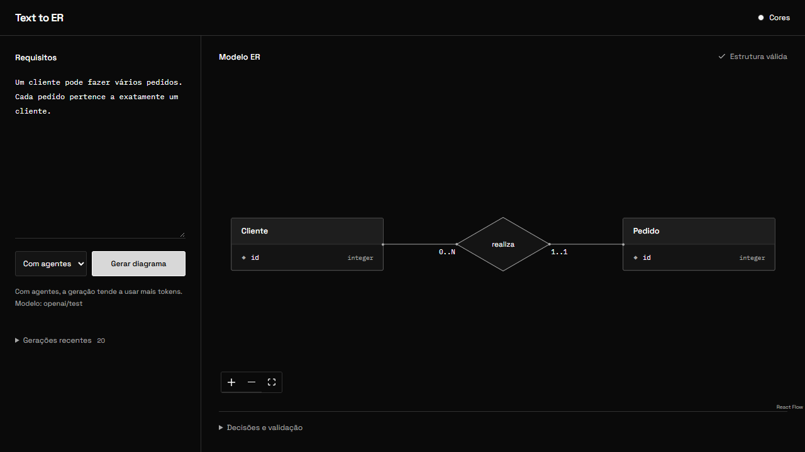

# Text to ER

Aplicação web que transforma requisitos em português em modelos conceituais de entidades e relacionamentos. Gere e visualize o diagrama, consulte o esquema em JSON e o relatório de validação, e acesse as gerações recentes salvas localmente em SQLite. Os resultados ajudam a iniciar a modelagem e devem ser revisados quanto à fidelidade aos requisitos.



## Rodar a aplicação

Pré-requisitos para estes comandos: Python 3.13 e Node.js 22. Na raiz do projeto:

```powershell
python -m venv .venv
.\.venv\Scripts\Activate.ps1
python -m pip install -e './backend[llm]'
npm --prefix frontend ci
if (-not (Test-Path backend/.env)) { Copy-Item backend/.env.example backend/.env }
```

No macOS ou Linux, ative o ambiente com `source .venv/bin/activate`. Se `backend/.env` ainda não existir, crie-o com `cp backend/.env.example backend/.env`.

Em `backend/.env`, defina `MODEL` com o prefixo do provedor (por exemplo, `openai/<modelo>` ou `gemini/<modelo>`) e `API_KEY`. Se o arquivo já existir, edite-o e remova a configuração antiga `MODE`. A chave fica no backend.

Com o ambiente virtual ativo, inicie o backend:

```powershell
cd backend
python -m uvicorn app.main:app --env-file .env
```
Em outro terminal aberto na raiz, execute `npm --prefix frontend run dev`.

Abra a [aplicação](http://127.0.0.1:5173), edite os requisitos e escolha **Direta** ou **Com agentes** antes de clicar em **Gerar diagrama**. Compare o diagrama e as suposições com o texto original. As chamadas usam a cota do provedor, e o histórico local guarda o texto enviado. A [documentação interativa da API](http://127.0.0.1:8000/docs) também fica disponível.

## Como funciona

1. O FastAPI entrega o requisito ao serviço de geração. **Direta** faz uma chamada ao modelo. **Com agentes** usa um coordenador para rascunhar e finalizar o modelo, com duas revisões em paralelo para coerência e cardinalidade. As quatro chamadas tendem a usar mais tokens.
2. O Pydantic verifica o formato. Regras em Python conferem identificadores, nomes duplicados e referências entre entidades. Saídas fora do contrato são rejeitadas. Esquemas legíveis com erros de integridade ficam disponíveis no histórico junto com o relatório.
3. O React Flow renderiza o esquema. O resultado inclui suposições e ambiguidades para revisão humana.

A validação estrutural não mede fidelidade ao requisito. O escopo é modelagem conceitual, com revisão humana das entidades e cardinalidades. A aplicação não gera nem executa SQL a partir do modelo. Veja os [pontos de entrada do código](docs/architecture.md).

Usei o Codex para apoiar o planejamento, a implementação e as verificações. Os testes simulam respostas do provedor e verificam o comportamento do pipeline. A qualidade semântica da geração ainda precisa de avaliação com casos de referência.

## Verificações

```powershell
python -m pip install -e './backend[dev]'
cd backend
python -m pytest
python -m ruff check .
python -m mypy
cd ../frontend
npm test
npm run build
```

A CI executa essas verificações sem credenciais. Para incluir os testes de transporte HTTP simulado do SDK, instale também o extra `llm`. Para verificar a aplicação no Chromium, rode `npx playwright install chromium` e `npm run test:e2e` em `frontend`, com o ambiente virtual ativo e as portas 5173 e 8000 livres. Os testes de navegador usam um transporte simulado e um histórico separado.
